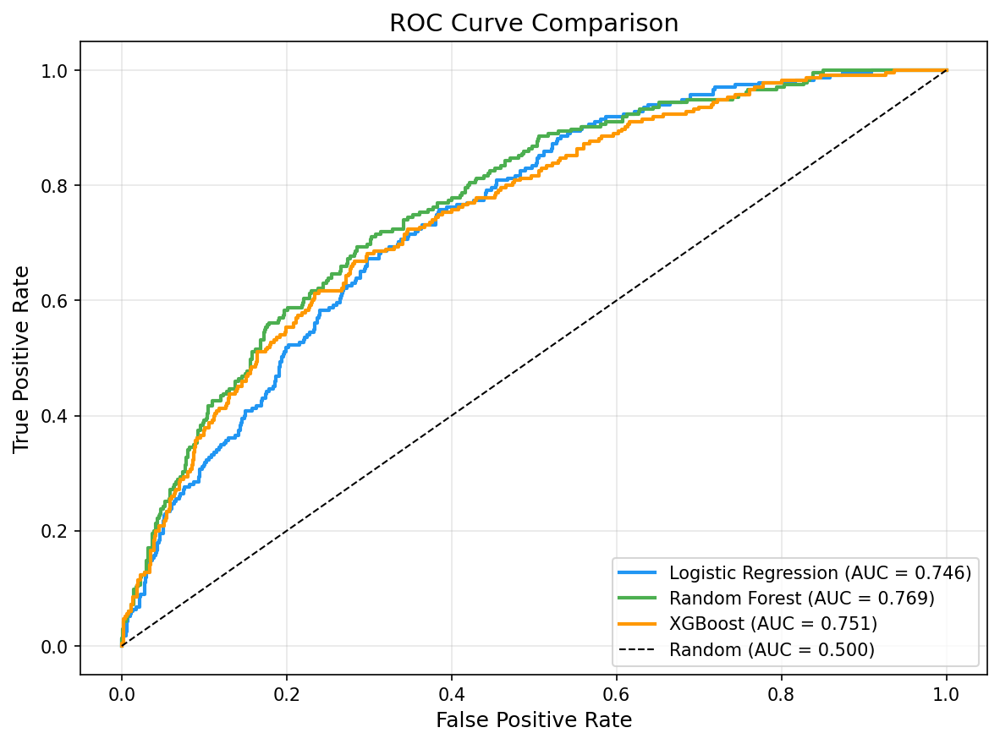
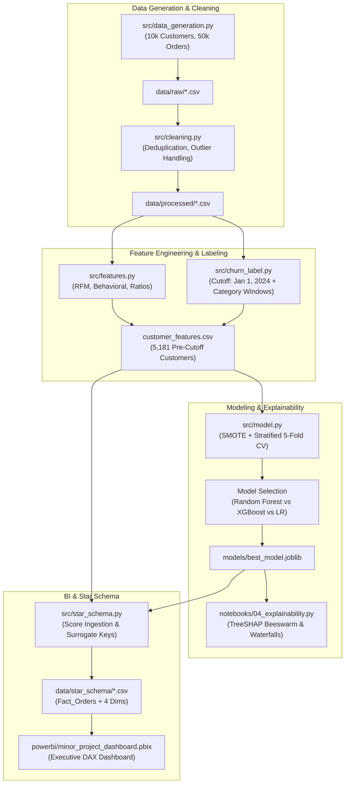
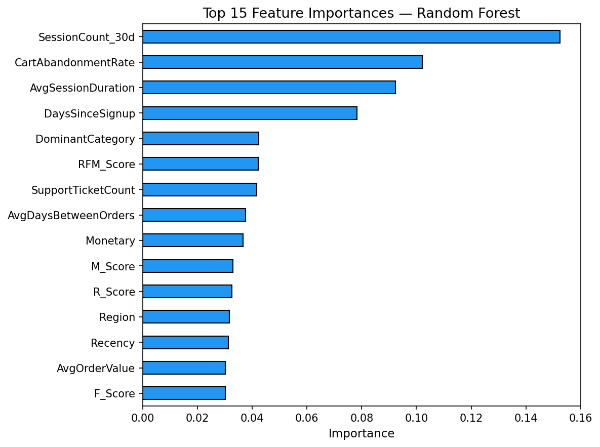
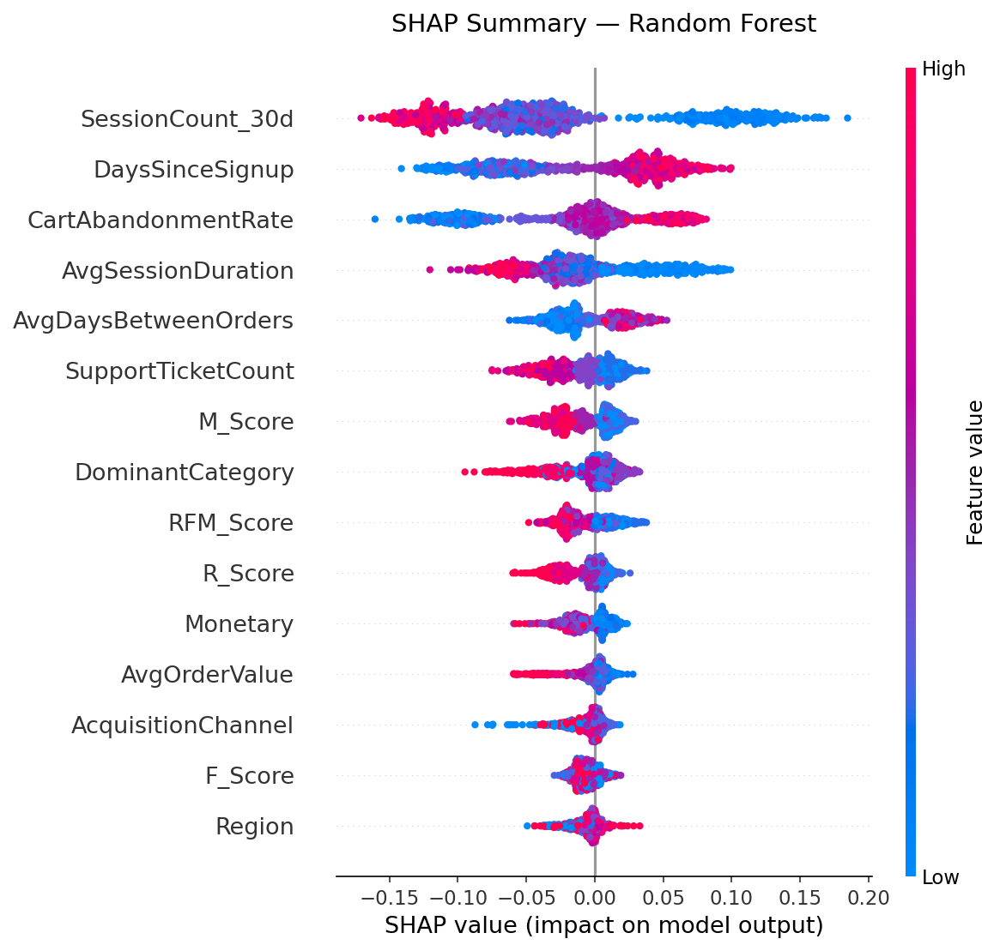
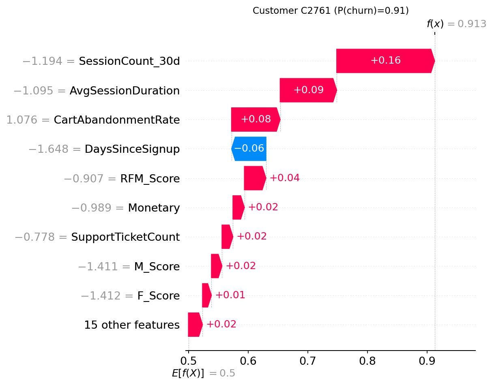

# E-Commerce Customer Churn Prediction & Lifetime Value Intelligence

<p align="center">
  
</p>

<p align="center">
  <a href="#tech-stack"></a>
  <a href="#machine-learning-results"></a>
  <a href="#power-bi-integration"></a>
  <a href="#explainability-shap"></a>
  <a href="docs/Churn_Project_Report_IET_Format.pdf"></a>
  <a href="#license"></a>
</p>

---

> **Academic Minor Project — Computer Science Engineering, Semester 5**  
> **Author:** Suwaaq Kothari  
> **Format:** Institute of Engineering & Technology (IET) Academic Project Guidelines  
> ⚠️ **Synthetic Dataset Notice:** Utilizes a statistically sound synthetic e-commerce dataset generated via NumPy and Faker (seed=42). See [Synthetic Data Methodology](#synthetic-data-methodology).

---

## Table of Contents

- [Executive Summary](#executive-summary)
- [Key Features & Highlights](#key-features--highlights)
- [Repository Structure](#repository-structure)
- [End-to-End Pipeline Architecture](#end-to-end-pipeline-architecture)
- [Methodology & Innovations](#methodology--innovations)
  - [1. Snapshot / Cutoff Churn Formulation](#1-snapshot--cutoff-churn-formulation)
  - [2. Category-Adjusted Inactivity Windows](#2-category-adjusted-inactivity-windows)
  - [3. Class Imbalance Handling (SMOTE)](#3-class-imbalance-handling-smote)
  - [4. Heuristic Predicted CLTV](#4-heuristic-predicted-cltv)
- [Machine Learning Results](#machine-learning-results)
  - [Model Comparison Benchmark](#model-comparison-benchmark)
  - [Cross-Validation Stability](#cross-validation-stability)
  - [Feature Importance & Leakage Verification](#feature-importance--leakage-verification)
- [Explainability (SHAP Analysis)](#explainability-shap-analysis)
- [Power BI Star Schema & BI Dashboard](#power-bi-star-schema--bi-dashboard)
- [Getting Started & Reproducibility](#getting-started--reproducibility)
  - [Prerequisites](#prerequisites)
  - [Installation](#installation)
  - [Execution Order](#execution-order)
- [Project Documentation](#project-documentation)
- [Tech Stack](#tech-stack)
- [License](#license)

---

## Executive Summary

Customer acquisition costs (CAC) in contemporary e-commerce outpace retention expenses by a factor of 5 to 7. Identifying customers at risk of churn before they defect enables marketing and growth teams to execute targeted, high-ROI retention interventions.

This project delivers an **end-to-end, production-grade machine learning and business intelligence pipeline** that:
1. Generates and validates an 18-month transactional e-commerce dataset (~10,000 customers, ~50,400 orders).
2. Prevents temporal data leakage through a strict **cutoff/snapshot experimental design**.
3. Dynamically accounts for distinct product replenishment cadences with **category-adjusted churn windows**.
4. Benchmarks **Logistic Regression**, **Random Forest**, and **XGBoost** with SMOTE oversampling.
5. Employs **TreeSHAP** to yield global feature rankings and individual customer risk attribution waterfalls.
6. Compiles a validated **Kimball Star Schema** ingested directly by an interactive **Power BI Executive Dashboard**.

---

## Key Features & Highlights

- **Leakage-Free Feature Engineering:** Rigorous temporal separation between feature observation (pre-cutoff) and churn labeling (post-cutoff). Recency is proven non-leaking (ranks #13, not #1).
- **Domain-Aware Inactivity Windows:** Eliminates the flaw of fixed 90-day inactivity thresholds by tailoring churn windows from 90 days (groceries) to 180 days (furniture).
- **Explainable Predictions:** Full global and local interpretability via SHAP summary beeswarm and customer-specific waterfall diagnostics.
- **Enterprise Star Schema:** Dimensional model with verified referential integrity (`Fact_Orders` + 4 dimension tables).
- **Native Power BI Integration:** Includes a pre-configured `.pbix` dashboard with custom DAX measures for Revenue at Risk, Churn Rate, and Customer Retention.

---

## Repository Structure

```
Minor Project/
├── .gitignore                      # Git exclusion rules (pycache, envs, pbix temp)
├── requirements.txt                # Pinned dependency requirements
├── README.md                       # Master project documentation
│
├── data/                           # Data storage (stratified by pipeline stage)
│   ├── raw/                        # Initial synthetic transactional CSVs
│   │   ├── customers.csv
│   │   ├── orders.csv
│   │   └── behaviour_support.csv
│   ├── processed/                  # Cleaned, joined & feature-engineered CSVs
│   │   ├── customers_cleaned.csv
│   │   ├── orders_cleaned.csv
│   │   ├── behaviour_support_cleaned.csv
│   │   ├── customer_features.csv
│   │   └── customer_scores.csv
│   └── star_schema/                # Kimball Star Schema tables (Power BI ready)
│       ├── Dim_Customer.csv
│       ├── Dim_Date.csv
│       ├── Dim_Product.csv
│       ├── Dim_SupportTicket.csv
│       └── Fact_Orders.csv
│
├── docs/                           # Formal project reports & guidelines
│   ├── README.md                   # Documentation manifest
│   └── Churn_Project_Report_IET_Format.pdf  # Academic report (IET format)
│
├── models/                         # Serialized models & performance artifacts
│   ├── best_model.joblib           # Trained Random Forest classifier
│   ├── evaluation_metrics.json     # Test & cross-validation scores
│   ├── feature_importance.csv      # Gini importance table
│   └── shap_feature_importance.csv # Mean absolute SHAP values
│
├── notebooks/                      # Sequential pipeline notebooks / execution scripts
│   ├── 01_eda.py                   # Exploratory Data Analysis & visual reporting
│   ├── 02_feature_engineering.py   # Cleaning, RFM, behavior, & churn labeling
│   ├── 03_model_training.py        # Model training, SMOTE, CV & evaluation
│   ├── 04_explainability.py        # TreeSHAP beeswarm & waterfall explanations
│   └── 05_star_schema_export.py    # Dimension & fact extraction for Power BI
│
├── powerbi/                        # Business Intelligence dashboard assets
│   ├── README.md                   # Power BI setup and import guide
│   └── minor_project_dashboard.pbix# Pre-built Power BI dashboard report
│
├── reports/                        # Visual plots, EDA findings & DAX documentation
│   ├── eda_summary.md              # EDA findings & metric commentary
│   ├── model_evaluation.md         # Full ML benchmark & confusion matrix analysis
│   ├── dax_measures.md             # Complete DAX formulas for Power BI
│   └── *.png                       # Visualizations (ROC, SHAP, Heatmaps, etc.)
│
├── scripts/                        # Utility & schema maintenance scripts
│   ├── README.md                   # Script execution instructions
│   ├── fix_churn_flag.py           # Calibration of classification threshold (0.40)
│   ├── fix_date_gaps.py            # Contiguous date dimension builder
│   ├── fix_dimCustomer.py          # Denormalization of churn scores to Dim_Customer
│   └── fix_dim_customer_duplicates.ipynb # Merge column deduplication notebook
│
└── src/                            # Modular pipeline Python packages
    ├── __init__.py
    ├── data_generation.py          # Synthetic e-commerce dataset generator
    ├── cleaning.py                 # Outlier removal, missing values, typing
    ├── features.py                 # RFM, temporal, & behavioral feature synthesis
    ├── churn_label.py              # Category-adjusted churn cutoff labeling
    ├── model.py                    # Training harnesses, scoring & metrics
    └── star_schema.py              # Kimball schema builders & constraint validators
```

---

## End-to-End Pipeline Architecture



---

## Methodology & Innovations

### 1. Snapshot / Cutoff Churn Formulation
In non-contractual e-commerce, customers never explicitly cancel accounts; they simply cease purchasing. Conventional naive models compute features across the entire historical period, causing **target leakage** where recent purchase inactivity artificially inflates model accuracy.

To resolve this, we enforce a strict **January 1, 2024 cutoff**:
- **Feature Window (Jan 1, 2023 – Dec 31, 2023):** All predictive features (Recency, Frequency, Monetary, session activity, support tickets) are extracted exclusively from orders placed prior to the cutoff.
- **Target Observation Window (Post-Jan 1, 2024):** Churn status is determined by observing customer repurchases after the cutoff.

### 2. Category-Adjusted Inactivity Windows
A customer who has not bought groceries in 90 days has almost certainly churned. However, a customer buying furniture naturally operates on a multi-month replacement cycle. We assign dynamic churn horizons scaled by $1.5\times$ category purchase intervals:

| Product Category | Expected Cycle | Churn Window ($1.5\times$) | Observation Horizon End |
|---|---|---|---|
| Electronics Accessories | 60 days | 90 days | April 1, 2024 |
| Groceries | 60 days | 90 days | April 1, 2024 |
| Clothing | 90 days | 135 days | May 16, 2024 |
| Beauty | 90 days | 135 days | May 16, 2024 |
| Books | 90 days | 135 days | May 16, 2024 |
| Home & Garden | 105 days | 157 days | June 7, 2024 |
| Sports | 105 days | 157 days | June 7, 2024 |
| Furniture | 120 days | 180 days | June 29, 2024 |

A customer is flagged as **Churned (`ChurnFlag = 1`)** if and only if they placed **zero transactions** between the cutoff and their specific category window expiration.

### 3. Class Imbalance Handling (SMOTE)
In the modelled pre-cutoff cohort (5,181 customers), true churners account for **22.6% (1,172 churned vs. 4,009 retained)**. To prevent the classifiers from biasing heavily toward majority class retention:
- **SMOTE (Synthetic Minority Over-sampling Technique)** is fitted **only on the training partition** ($80\%$ split, 4,144 records) during cross-validation, strictly preventing test fold leakage.
- Secondary cost-sensitive weighting (`class_weight='balanced'`) is combined to optimize detection sensitivity.

### 4. Heuristic Predicted CLTV
For scored customers, forward-looking Customer Lifetime Value is projected using an explainable heuristic:

$$\text{Predicted CLTV} = \text{AvgOrderValue} \times \min\left(\text{Frequency} \times \frac{365}{\text{TenureDays}},\, 52\right) \times (1 - \text{ChurnProbability})$$

---

## Machine Learning Results

### Model Comparison Benchmark
Evaluated on an independent, unseen 20% holdout test set (1,037 customers, 235 true churners):

| Classifier | AUC-ROC | Precision | Recall | F1-Score | Accuracy |
|---|---|---|---|---|---|
| Logistic Regression | 0.7460 | 0.3861 | **0.6851** | 0.4939 | 0.6818 |
| **Random Forest (Selected)** | **0.7689** | **0.4745** | 0.5149 | **0.4939** | **0.7608** |
| XGBoost Classifier | 0.7507 | 0.4520 | 0.5404 | 0.4922 | 0.7473 |

> **Diagnostic Note on F1 Coincidence:** Logistic Regression and Random Forest achieve the exact same F1 score (0.4939) via divergent precision/recall trade-offs. Logistic Regression operates aggressively (flags 417 customers; 161 TP, 256 FP), whereas Random Forest operates with high precision (flags 255 customers; 121 TP, 134 FP). Random Forest was selected as the operational champion for superior AUC-ROC (0.7689) and lower false positive intervention costs.

### Cross-Validation Stability
5-fold stratified cross-validation on the training set confirms consistent model ranking:
- **Random Forest:** Mean AUC = **0.7774** ($\pm 0.0136$)
- **Logistic Regression:** Mean AUC = **0.7640** ($\pm 0.0181$)
- **XGBoost:** Mean AUC = **0.7527** ($\pm 0.0128$)

### Feature Importance & Leakage Verification
Gini feature importance ranking confirms complete absence of data leakage:

| Rank | Feature | Gini Importance | Interpretation |
|---|---|---|---|
| 1 | `SessionCount_30d` | 0.1524 | Customer digital engagement level (strongest signal) |
| 2 | `CartAbandonmentRate` | 0.1021 | Frustration and purchase friction indicator |
| 3 | `AvgSessionDuration` | 0.0924 | Time invested exploring the catalog |
| 4 | `DaysSinceSignup` | 0.0783 | Overall customer lifecycle maturity |
| 5 | `DominantCategory` | 0.0424 | Product mix category characteristics |
| **13** | **`Recency`** | **0.0313** | **Ranked #13 — Validates that temporal leakage was eliminated** |

<p align="center">
  
</p>

---

## Explainability (SHAP Analysis)

TreeSHAP analysis exposes the exact feature dynamics governing individual churn probabilities:

<p align="center">
  
</p>

- **Low Recent Sessions (`SessionCount_30d`):** Strongly pulls risk toward churn (+SHAP).
- **High Cart Abandonment (`CartAbandonmentRate`):** Correlates with elevated churn vulnerability.
- **Short Tenure (`DaysSinceSignup`):** Newer accounts display higher volatility and churn inclination.

### Individual Waterfall Diagnostic
For each customer scored, a local SHAP waterfall explains the specific reasons behind their risk classification:

<p align="center">
  
</p>

---

## Power BI Star Schema & BI Dashboard

The data pipeline exports a fully compliant Kimball star schema into `data/star_schema/` for direct ingestion into Power BI Desktop (`powerbi/minor_project_dashboard.pbix`).

### Dimensional Schema Architecture

```
                    ┌────────────────────────┐
                    │        Dim_Date        │
                    │  PK: DateKey           │
                    │  FullDate, Year, Month │
                    └───────────┬────────────┘
                                │ 1:N
  ┌──────────────────────┐      │      ┌──────────────────────┐
  │     Dim_Customer     │      │      │     Dim_Product      │
  │  PK: CustomerID      │──1:N─┼─N:1──│  PK: ProductID       │
  │  Age, Gender, Region │      │      │  ProductName,        │
  │  RFM_Score, Segment  │      │      │  ProductCategory     │
  └──────────┬───────────┘      │      └──────────────────────┘
             │           ┌──────┴─────────────┐
             │           │    Fact_Orders     │
             │           │  PK: OrderID       │
             │           │  FK: CustomerID    │
             │           │  FK: DateKey       │
             │           │  FK: ProductID     │
             │           │  OrderAmount       │
             │           │  ChurnProbability  │
             │           │  ChurnFlag         │
             │           │  PredictedCLTV     │
             │           │  IsScored          │
             │           └────────────────────┘
  ┌──────────┴───────────────┐
  │    Dim_SupportTicket     │
  │  PK: CustomerID          │
  │  SupportTicketCount      │
  │  CartAbandonmentRate     │
  └──────────────────────────┘
```

### Key DAX Measures
All DAX calculations strictly filter on `Fact_Orders[IsScored] = 1` to ensure unscored post-cutoff signups do not distort churn KPIs:

- **Churn Rate:** `DIVIDE(CALCULATE(DISTINCTCOUNT(Fact_Orders[CustomerID]), Fact_Orders[IsScored]=1, Fact_Orders[ChurnFlag]=1), CALCULATE(DISTINCTCOUNT(Fact_Orders[CustomerID]), Fact_Orders[IsScored]=1), 0)`
- **Revenue at Risk:** `CALCULATE(SUM(Fact_Orders[OrderAmount]), Fact_Orders[IsScored]=1, Fact_Orders[ChurnFlag]=1)`
- **Retention Rate:** `1 - [Churn Rate]`
- See [`reports/dax_measures.md`](reports/dax_measures.md) for the complete measure dictionary.

---

## Getting Started & Reproducibility

### Prerequisites
- Python 3.10, 3.11, or 3.12
- Git
- Power BI Desktop (optional, for viewing `.pbix`)

### Installation

```bash
# 1. Clone repository
git clone https://github.com/<username>/<repo-name>.git
cd <repo-name>

# 2. Initialize virtual environment
python -m venv venv
# Windows:
venv\Scripts\activate
# Linux/macOS:
source venv/bin/activate

# 3. Install dependencies
pip install -r requirements.txt
```

### Execution Order
The pipeline is fully **idempotent**. Executing the notebooks in numerical order reproduces the entire project from raw data to Power BI tables:

```bash
# Step 1: Exploratory Data Analysis & visual generation
python notebooks/01_eda.py

# Step 2: Data Cleaning, RFM Engineering & Churn Labeling
python notebooks/02_feature_engineering.py

# Step 3: Model Training, Cross-Validation & Metric Serialization
python notebooks/03_model_training.py

# Step 4: Model Explainability & SHAP Waterfall Generation
python notebooks/04_explainability.py

# Step 5: Star Schema Synthesis & Export for Power BI
python notebooks/05_star_schema_export.py
```

> **Note:** All `.py` files in `notebooks/` use `# %%` interactive cell dividers and can be executed cell-by-cell in VS Code, PyCharm, or Jupyter.

---

## Synthetic Data Methodology

To enable full reproducibility without violating customer privacy or relying on restricted commercial telemetry, this project uses a custom synthetic generation engine (`src/data_generation.py`):
- **Customer Base:** 10,000 customers with uniform registration across 18 months.
- **Transaction Generation:** ~50,400 orders parameterized via Poisson arrival rates $(\lambda)$ mapped to customer segments.
- **Pricing & Categories:** Category-stratified price distributions across 8 distinct merchandise domains.
- **Support & Returns:** Correlated negative experiences (support ticket frequency tied to return velocity).
- **Random Seed:** Pinned to `seed=42` across NumPy, Faker, and Scikit-learn for strict deterministic reproducibility.

---

## Tech Stack

| Domain | Tool / Library | Version | Usage |
|---|---|---|---|
| **Language** | Python | `3.12` | Core computing environment |
| **Data Manipulation** | `pandas`, `numpy` | `^2.3.0` | Vectorized wrangling & Star Schema assembly |
| **Machine Learning** | `scikit-learn` | `^1.7.0` | Logistic Regression, Random Forest, metrics |
| **Gradient Boosting** | `xgboost` | `^3.4.0` | Gradient-boosted decision trees |
| **Imbalanced Data** | `imbalanced-learn` | `^0.14.0`| Training-fold SMOTE oversampling |
| **Model Explainability** | `shap` | `^0.52.0` | TreeSHAP values, beeswarms, waterfalls |
| **Visualization** | `matplotlib`, `seaborn`| `^3.10.0` / `^0.13.0` | Statistical plotting & report exports |
| **Data Synthesis** | `faker` | `^40.0.0` | Demographics & customer entity synthesis |
| **Business Intelligence**| Power BI Desktop | `Latest` | Star Schema data model & executive dashboard |

---

## Project Documentation

Detailed technical breakdowns and academic deliverables are located in their respective folders:
- 📄 **Academic Report:** [`docs/Churn_Project_Report_IET_Format.pdf`](docs/Churn_Project_Report_IET_Format.pdf)
- 📊 **Model Benchmark Report:** [`reports/model_evaluation.md`](reports/model_evaluation.md)
- 📈 **Exploratory Data Analysis Report:** [`reports/eda_summary.md`](reports/eda_summary.md)
- 📐 **DAX Measures Formula Reference:** [`reports/dax_measures.md`](reports/dax_measures.md)
- 🛠️ **Utility Scripts Guide:** [`scripts/README.md`](scripts/README.md)
- 📉 **Power BI Import Manual:** [`powerbi/README.md`](powerbi/README.md)

---

## License

This project is submitted in fulfillment of the **Academic Minor Project (Semester 5)** requirement in Computer Science & Engineering. Available for academic review and educational use.
