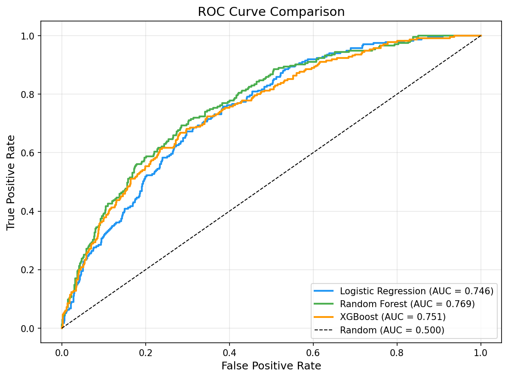
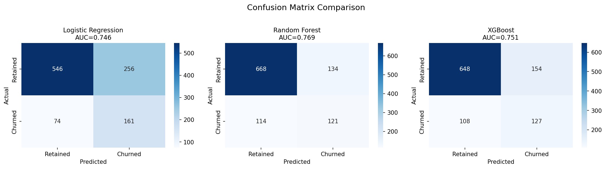
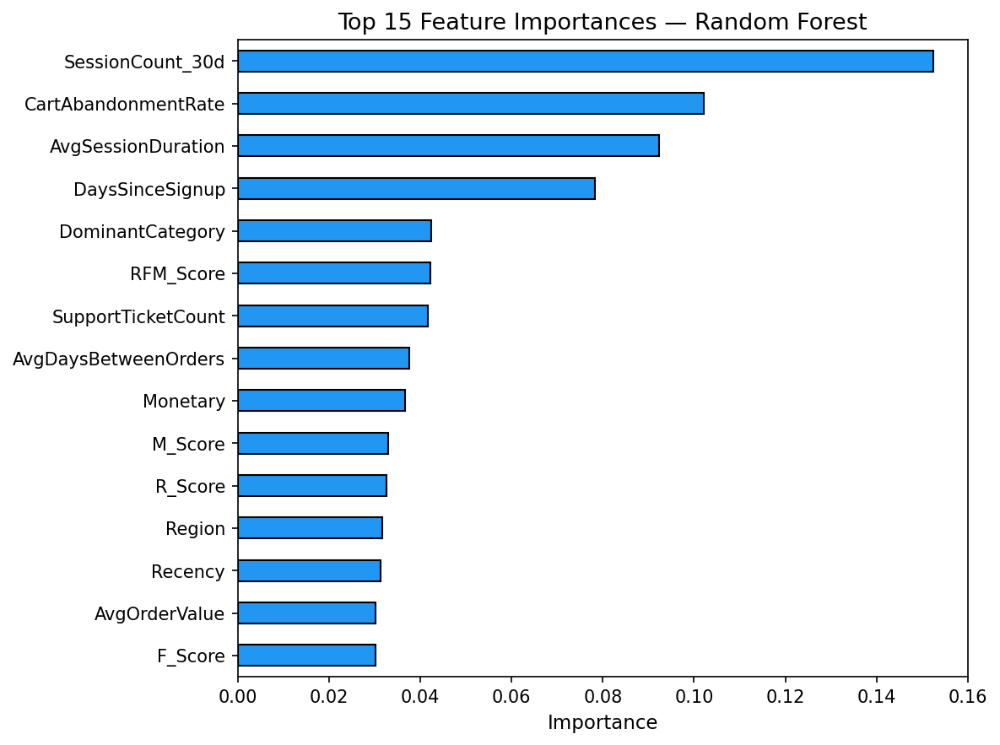
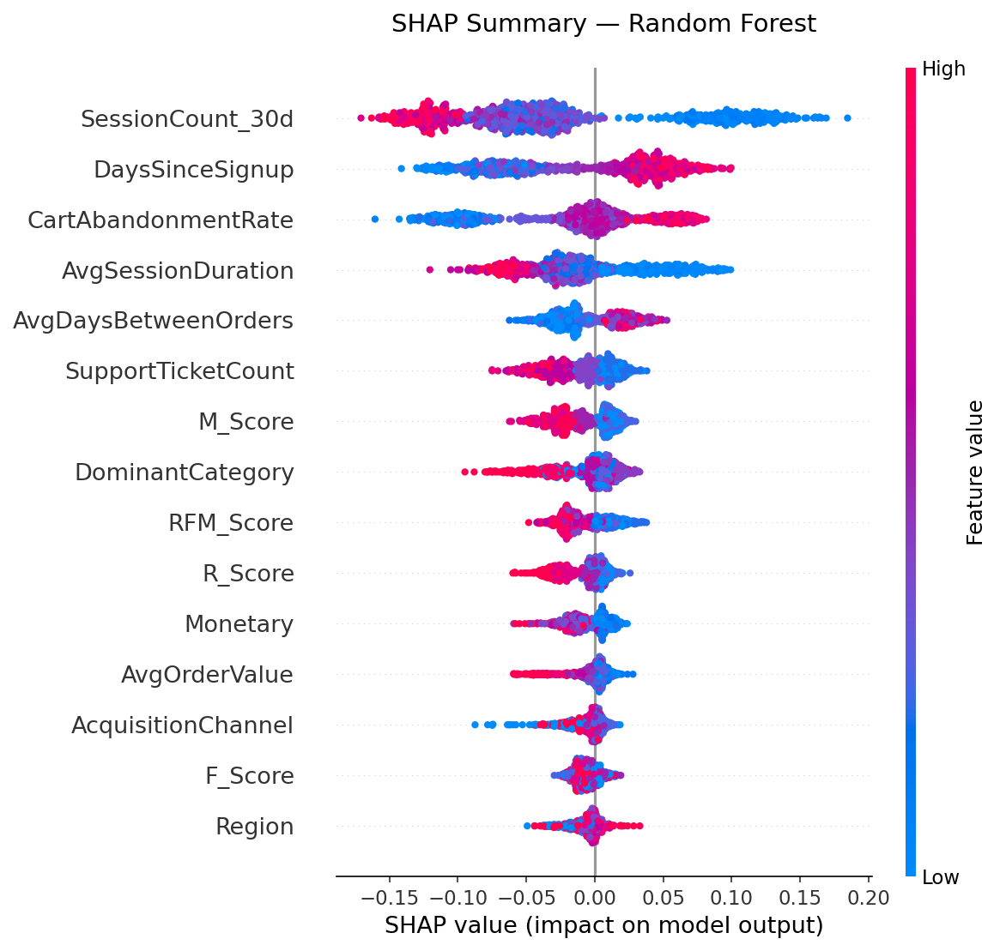
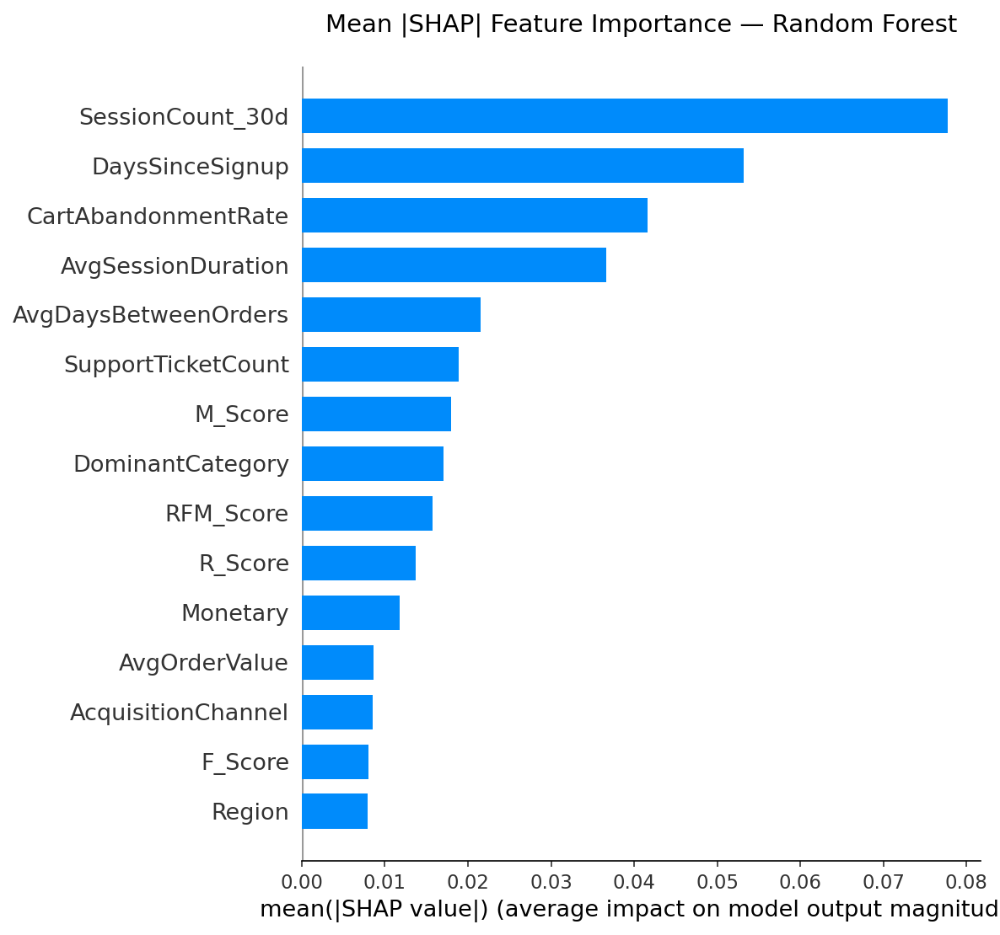
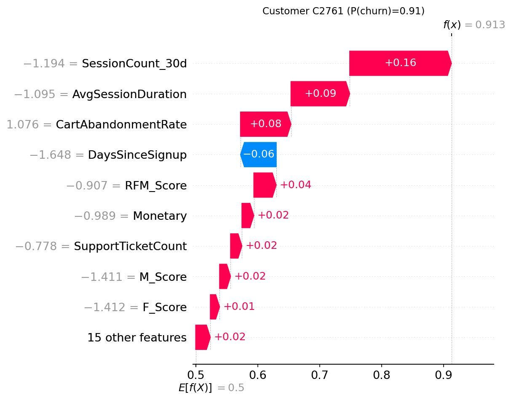
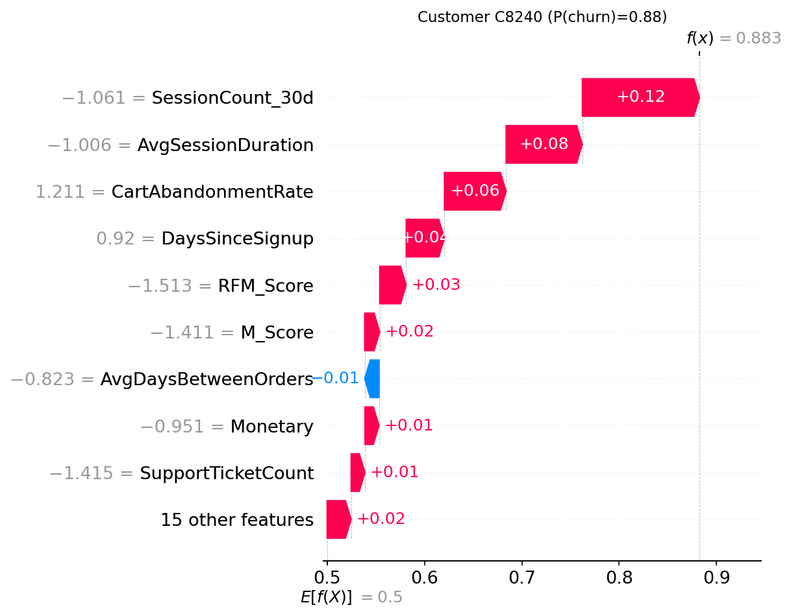
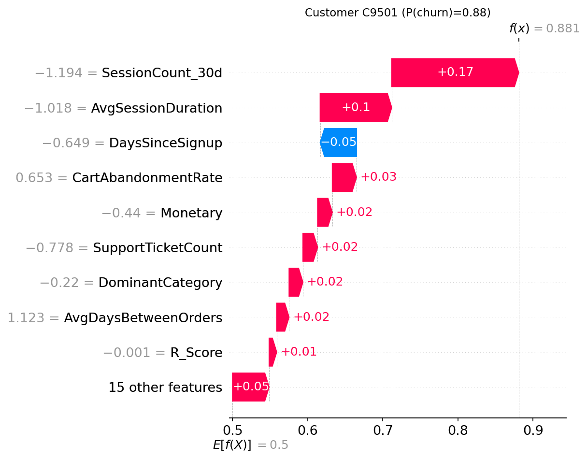

# Model Evaluation Report

## 1. Experiment Setup

| Parameter | Value |
|-----------|-------|
| Dataset | Synthetic: 10,000 customers, 50,404 orders (Jan 2023 – Jun 2024) |
| **Cutoff date** | **January 1, 2024 (month 12 of the 18-month window)** |
| **Feature window** | **All orders BEFORE Jan 1, 2024** (12 months of history) |
| **Churn observation window** | **Orders AFTER Jan 1, 2024**, category-adjusted (see below) |
| Modelled customers | 5,181 (customers with at least 1 pre-cutoff order) |
| Churn rate | 22.6% (1,172 churned / 4,009 retained) |
| Train/Test split | 80/20 stratified (4,144 train / 1,037 test) |
| Class imbalance handling | SMOTE on training data only |
| Features | 24 numeric features (after label encoding) |
| Cross-validation | 5-fold stratified |

### Cutoff & Churn Window Detail

Features (Recency, Frequency, Monetary, etc.) are computed from orders **strictly before** January 1, 2024. The churn label is then determined by checking for orders **after** the cutoff within a category-adjusted window:

| Category | Expected Cycle | Churn Window (×1.5) | Window End Date |
|----------|---------------|-------------------|----------------|
| Electronics Accessories / Groceries | 60 days | 90 days | Apr 1, 2024 |
| Clothing / Beauty / Books | 90 days | 135 days | May 16, 2024 |
| Home & Garden / Sports | 105 days | 157 days | Jun 7, 2024 |
| Furniture | 120 days | 180 days | Jun 29, 2024 |

A customer is **churned** (ChurnFlag=1) if they placed **zero orders** between the cutoff and their category-specific window end.

### Unscored Customers

Of 10,000 total customers, **4,819 signed up after the cutoff** or had no pre-cutoff orders. These customers:
- Are **excluded from modelling** (no features to compute)
- Appear in `Fact_Orders` with `IsScored = 0`, `ChurnFlag = -1`, `ChurnProbability = -1`, `PredictedCLTV = -1`
- Dashboard DAX measures filter on `IsScored = 1` to avoid inflating churn metrics

---

## 2. Model Comparison — Test Set

| Model | AUC-ROC | Precision | Recall | F1 | Accuracy |
|-------|---------|-----------|--------|-----|----------|
| Logistic Regression | 0.7460 | 0.3861 | 0.6851 | 0.4939 | 0.6818 |
| **Random Forest** | **0.7689** | **0.4745** | 0.5149 | **0.4939** | **0.7608** |
| XGBoost | 0.7507 | 0.4520 | 0.5404 | 0.4922 | 0.7473 |

> [!NOTE]
> LR and RF have identical **F1 scores** (0.4939) despite different precision/recall trade-offs. This is a genuine coincidence: LR achieves F1 via high recall (0.685) / low precision (0.386), while RF achieves the same F1 via moderate precision (0.475) / moderate recall (0.515). Mathematically, `2 × P × R / (P + R)` can produce the same harmonic mean from different P/R pairs.

### Raw Confusion Matrices

```
Logistic Regression          Random Forest              XGBoost
TN=546  FP=256               TN=668  FP=134             TN=648  FP=154
FN= 74  TP=161               FN=114  TP=121             FN=108  TP=127
```

**LR** is aggressive: it flags 417 customers (40%), catching 68.5% of true churners but with many false positives. **RF** is conservative: it flags only 255 customers (25%), with higher precision but lower recall.

### Threshold Sweep: Does RF Dominate at Every Recall Level?

LR's high recall (68.5%) at default threshold looks attractive for a retention campaign. But is it LR's intrinsic advantage, or can RF match that recall by lowering its threshold — and with better precision?

| RF Threshold | Precision | Recall | F1 | Accuracy | Flagged |
|-------------|-----------|--------|-----|----------|---------|
| 0.50 (default) | 0.4745 | 0.5149 | 0.4939 | 0.7608 | 255 |
| 0.45 | 0.4396 | 0.6043 | 0.5090 | 0.7358 | 323 |
| **0.40** | **0.4106** | **0.6936** | **0.5158** | **0.7049** | **397** |
| 0.35 | 0.3758 | 0.7532 | 0.5014 | 0.6606 | 471 |
| 0.30 | 0.3557 | 0.8128 | 0.4948 | 0.6239 | 537 |
| 0.25 | 0.3372 | 0.8766 | 0.4870 | 0.5815 | 611 |
| 0.20 | 0.3063 | 0.9149 | 0.4589 | 0.5111 | 702 |

**Head-to-head at matched recall (~69%):**

| Model | Threshold | Precision | Recall | F1 | Flagged |
|-------|-----------|-----------|--------|-----|---------|
| **RF** | **0.40** | **0.4106** | 0.6936 | **0.5158** | 397 |
| LR | 0.50 | 0.3861 | 0.6851 | 0.4939 | 417 |

> [!IMPORTANT]
> **RF dominates outright.** At the recall level where LR operates by default (~69%), RF at threshold=0.40 achieves **+2.5pp higher precision** (41.1% vs 38.6%), **+2.2pp higher F1** (0.516 vs 0.494), and **flags 20 fewer customers**. LR's default-threshold recall is not a genuine advantage — it is achievable (and exceeded) by RF with a lower threshold and better precision at every point on the curve.

## 3. Cross-Validation Results (5-Fold Stratified)

| Model | Mean AUC-ROC | Std |
|-------|-------------|-----|
| Logistic Regression | 0.7640 | ±0.0181 |
| **Random Forest** | **0.7774** | ±0.0136 |
| XGBoost | 0.7527 | ±0.0128 |

Random Forest achieves the highest AUC on both the test set (0.769) and cross-validation (0.777). It is selected as the best model.

## 4. Best Model: Random Forest

- **AUC-ROC**: 0.7689 — good discriminative ability
- **Recall**: 0.51 — catches ~51% of actual churners
- **Precision**: 0.47 — 47% of flagged customers are true churners
- **F1**: 0.49 — balanced performance

## 5. ROC Curve



## 6. Confusion Matrices



## 7. Full Feature Importance Ranking

### Built-in (Random Forest Gini Importance)

| Rank | Feature | Importance | Note |
|------|---------|------------|------|
| 1 | SessionCount_30d | 0.1524 | Engagement proxy — strongest predictor |
| 2 | CartAbandonmentRate | 0.1021 | Disengagement signal |
| 3 | AvgSessionDuration | 0.0924 | Time-on-site engagement |
| 4 | DaysSinceSignup | 0.0783 | Customer tenure |
| 5 | DominantCategory | 0.0424 | Product mix |
| 6 | RFM_Score | 0.0423 | Composite customer value |
| 7 | SupportTicketCount | 0.0417 | Service interaction |
| 8 | AvgDaysBetweenOrders | 0.0375 | Purchase cadence |
| 9 | Monetary | 0.0367 | Total spend |
| 10 | M_Score | 0.0329 | Monetary quintile |
| 11 | R_Score | 0.0326 | Recency quintile |
| 12 | Region | 0.0317 | Geography |
| **13** | **Recency** | **0.0313** | **Ranks #13 — NOT near-perfectly predictive (leakage check passed)** |
| 14 | AvgOrderValue | 0.0303 | Per-order spend |
| 15 | F_Score | 0.0302 | Frequency quintile |
| 16 | LastSupportResolutionTime | 0.0297 | Support responsiveness |
| 17 | Age | 0.0285 | Customer demographics |
| 18 | AcquisitionChannel | 0.0278 | How customer was acquired |
| 19 | OrderAmountStd | 0.0228 | Spending variability |
| 20 | Frequency | 0.0206 | Total pre-cutoff order count |
| 21 | UniqueCategories | 0.0202 | Category breadth |
| 22 | Gender | 0.0168 | Demographics |
| 23 | DiscountUsageRate | 0.0130 | Price sensitivity |
| 24 | ReturnRate | 0.0059 | Return behaviour |

> [!TIP]
> **Leakage check passed**: Recency ranks **#13 out of 24** with importance 0.031 — comparable to Region (#12, 0.032) and AvgOrderValue (#14, 0.030). It is a mild signal, not a dominant predictor. The cutoff design successfully decoupled Recency from the churn label.



### SHAP Values (Mean |SHAP|)

| Rank | Feature | Mean SHAP |
|------|---------|-----------|
| 1 | SessionCount_30d | 0.0778 |
| 2 | DaysSinceSignup | 0.0532 |
| 3 | CartAbandonmentRate | 0.0416 |
| 4 | AvgSessionDuration | 0.0366 |
| 5 | AvgDaysBetweenOrders | 0.0215 |





## 8. SHAP Waterfall — Individual Customer Explanations







## 9. Limitations & Discussion

1. **AUC = 0.77**: Good performance for synthetic data. Real e-commerce data with richer behavioural signals would likely yield higher AUC.
2. **5,181 of 10,000 customers modelled**: Only customers with pre-cutoff orders can be scored. The remaining 4,819 (signed up after Jan 2024 or had zero orders before then) appear in the fact table with `IsScored=0` so the dashboard can separate model-backed metrics from overall metrics.
3. **Recency is not leaking**: Recency (days since last pre-cutoff order) ranks #13 — it carries mild signal but is far from dominant. The snapshot/cutoff design is working as intended.
4. **F1 coincidence**: LR and RF achieve identical F1 (0.4939) through different precision/recall trade-offs — this is a genuine arithmetic coincidence, not a bug. The raw confusion matrices are different (LR: TN=546/FP=256/FN=74/TP=161 vs RF: TN=668/FP=134/FN=114/TP=121).
5. **CLTV is heuristic-based**: `AvgOrderValue × PredictedFreq12m × (1 - ChurnProbability)`. Suitable for directional insight, not precise financial forecasting.
